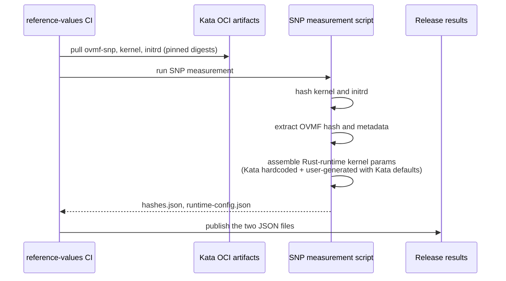
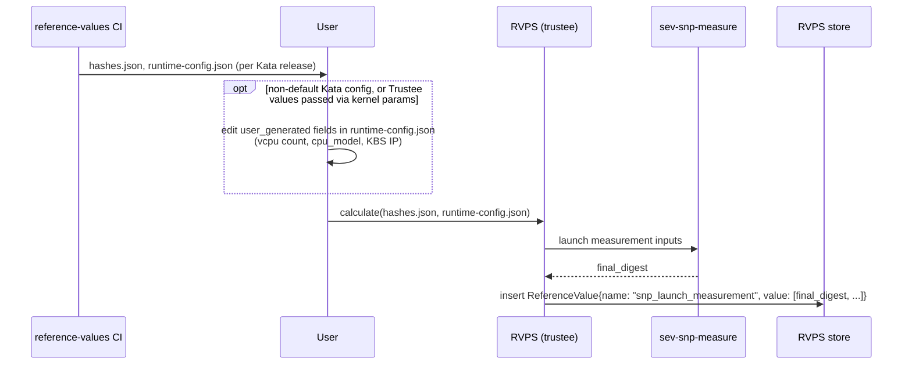

# SNP launch measurement: RVPS extractor implementation

Design for computing SEV-SNP launch measurement reference values: the `reference-values` repo publishes JSON inputs per release, and RVPS uses the `sev-snp-measure` tool to calculate the launch measurement from them. This is the detailed companion to the "RVPS extractor" option in the launch measurement issue, which covers the problem statement.

## 1. Overview

A single Kata release maps to many valid launch measurements, so the final digest has to be calculated per deployment. The work is split three ways:

- **reference-values (CI, per release):** publishes everything that does not depend on the deployment: kernel and initrd hashes, OVMF hash and metadata, and the kernel params.
- **User:** the workload or policy owner who registers the reference values. Optionally, they fill in the few deployment-specific values (vCPU count, CPU model and KBS IP), see section 2.2.
- **RVPS:** calls `sev-snp-measure` with those inputs and stores the result as the `snp_launch_measurement` reference value.

| Component | Change |
| --- | --- |
| reference-values repo | New SNP measurement plugin that publishes two JSON files |
| RVPS | New `snp-measurement` extractor that runs `sev-snp-measure` |
| Attestation Service, Kata, guest launch | None |

## 2. Flows

### 2.1 Step 1: reference-values builds the inputs (per release)

CI produces two files per release:

- [hashes.json](hashes.json): kernel and initrd hashes plus the OVMF hash and metadata.
- [runtime-config.json](runtime-config.json): kernel params assembled by the Rust runtime.



### 2.2 Step 2: user registers the files, optionally with their own values

Editing the values is an optional step. It is only needed if the user:

- wants to support a non-default Kata configuration, or
- passes the Trustee values (such as the KBS address) through kernel parameters instead of the preferred initdata method.

In that case the user edits the `user_generated` fields in [runtime-config.json](runtime-config.json). Otherwise the published files are used as they are. Either way, the user registers `runtime-config.json` with `hashes.json`. RVPS calculates the digest and stores it.



API:

```
calculate(hashes, runtime_config) -> final_digest
```

Registration goes through `rvps-tool` with a new extractor type, `snp-measurement`:

```
rvps-tool register --path provenance.json
```

```json
{
  "version": "0.1.0",
  "type": "snp-measurement",
  "payload": "<base64 of hashes.json and runtime-config.json>"
}
```

### 2.3 Attestation

Nothing changes. When the Attestation Service asks RVPS for the SNP launch measurement reference value, RVPS returns the list of measurements calculated earlier.

## 3. Publishing multiple files from reference-values

The reference-values build today produces a single value per measurement. SNP needs two files from one measurement. Proposed change:

- A measurement entry can list the files it produces.
- The measurement writes those files to a location provided by the build.
- The build adds the files to the release results.

The SNP measurement does not add an entry to the single-value results, since it produces files rather than one value.

## 4. Artifact formats

### 4.1 hashes.json

```json
{
  "kata_version": "3.30.0",
  "kernel_hash": "<sha256 hex>",
  "initrd_hash": "<sha256 hex>",
  "ovmf": {
    "ovmf_hash": [97, 72, 195, 4, "... 48 bytes in total"],
    "metadata_items": [
      { "gpa": 8388608, "size": 36864, "section_type": "SnpSecMemory" },
      { "gpa": 8429568, "size": 12288, "section_type": "SnpSecMemory" },
      { "gpa": 8441856, "size": 4096,  "section_type": "SnpSecrets" },
      { "gpa": 8445952, "size": 4096,  "section_type": "Cpuid" },
      { "gpa": 8450048, "size": 4096,  "section_type": "SvsmCaa" },
      { "gpa": 8458240, "size": 61440, "section_type": "SnpSecMemory" },
      { "gpa": 8454144, "size": 4096,  "section_type": "SnpKernelHashes" }
    ],
    "sev_es_reset_eip": 8433668,
    "sev_hashes_table_gpa": 8457216
  }
}
```

| Field | Use |
| --- | --- |
| `kernel_hash`, `initrd_hash` | SHA-256 of the artifacts, used for the kernel/initrd/cmdline hashes table. |
| `ovmf.ovmf_hash` | 48-byte pre-folded digest of the OVMF firmware pages (not the SHA-256 of the file). |
| `ovmf.metadata_items` | OVMF metadata sections, each placed at its `gpa` by `section_type`. |
| `ovmf.sev_hashes_table_gpa` | Where the hashes table goes, inside the `SnpKernelHashes` page. |
| `ovmf.sev_es_reset_eip` | Reset address used for the AP VMSA pages. |

The OVMF hash alone is not enough, because the OVMF metadata pages are part of the measurement and cannot be recovered from the hash. `sev-snp-measure` produces the same measurement whether it is given the OVMF binary or these precomputed values, so RVPS does not need the OVMF binary.

### 4.2 runtime-config.json

```json
{
  "runtime": "rust",
  "kata_version": "3.30.0",
  "kata_hardcoded_kernel_params": ["..."],
  "user_generated": {
    "vcpu": 1,
    "cpu_model": "EPYC-Milan",
    "cpu_family": 25,
    "cpu_model_number": 1,
    "cpu_stepping": 1,
    "kbs_ip": "0.0.0.0:8080"
  }
}
```

- `kata_hardcoded_kernel_params`: fixed by Kata version and runtime. The user does not change them.
- `user_generated`: the only fields the user edits. The KBS IP is here because it ends up in the kernel cmdline.
- `cpu_family`, `cpu_model_number`, `cpu_stepping`: optional, in addition to `cpu_model`.

### 4.3 Where each input comes from

| Source | Examples | Handled by |
| --- | --- | --- |
| Kata config toml | vcpus, vcpu type, kernel, OVMF, `dm-mod.create`, `rootfstype`, debug, `selinux`, `agent.*`, cgroup | Pre-filled with Kata defaults; the user changes only what differs in their deployment |
| Kata hardcoded | static kernel params | `kata_hardcoded_kernel_params` |
| User generated | `nr_cpus`, `initcall_debug`, `agent.aa_kbc_params` (KBS IP) | `user_generated` |
| OVMF | OVMF hash, metadata, reset address | `hashes.json` (generated, not edited) |

## 5. Caveat

The launch measurement depends on the exact kernel params and their order. The reference value must be updated every time the order of the kernel params changes, for example when a new Kata release reorders them.

## 6. Delivery order

1. reference-values: SNP measurement and publishing of multiple files.
2. RVPS: `snp-measurement` extractor and registration path.
3. End-to-end test on real SNP hardware, with the Rust runtime.
